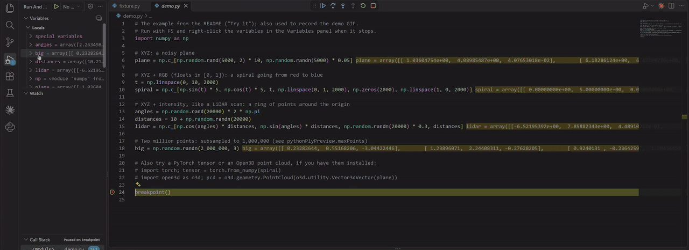

# Python PLY Preview

[](https://opensource.org/licenses/MIT)
[](https://marketplace.visualstudio.com/items?itemName=cmaranes.python-ply-preview)


🚀 See your point clouds while you debug. Pause your Python program, right-click a variable, and it opens in a 3D viewer next to your code.

Works with **NumPy** arrays, **PyTorch** tensors and **Open3D** point clouds. Only NumPy is needed in your environment, and no other extension.



## Features

  * **3D viewer inside VS Code:** rotate, pan and zoom; color by RGB, by height or with a single color; Z-up or Y-up; axes, grid, point count and bounding box.
  * **Preview from anywhere while debugging:** the Variables and Watch panels, the lightbulb on a variable, a selected expression such as `pcd.points` or `batch[0]`, or the Command Palette.
  * **Any stack frame:** variables are read from the frame selected in the Call Stack.
  * **Large clouds stay fast:** clouds over 1,000,000 points are subsampled before they leave Python (configurable).
  * **Docker and remote debugging:** when the Python process can't share files with VS Code, the cloud comes through the debugger.
  * **Open `.ply` files** in the same viewer.

-----

## How to Use

1.  Start your program in **Debug Mode** (F5) and pause it at a breakpoint.
2.  Open a point cloud in any of these ways:
    * Right-click a variable in the **Variables** or **Watch** panel and pick **View as Point Cloud (PLY)**.
    * Put the cursor on a variable, or **select an expression** such as `pcd.points` or `batch[0]`, and pick **View PLY** from the lightbulb / quick fix menu (`Ctrl+.`).
    * Right-click in the editor, or run **Python PLY Preview: View as Point Cloud (PLY)** from the Command Palette.
3.  The point cloud opens in a viewer tab beside your code. Viewing the same variable again, for example after stepping, updates that tab.

### The viewer

  * **Rotate** with the left mouse button, **pan** with the right one, **zoom** with the wheel. **Reset view** fits the cloud again.
  * **Color** by the cloud's own **RGB** colors, by **height** along the up axis, or with a **solid** color.
  * **Up** axis: **Z** (robotics, LiDAR) or **Y** (graphics). **Axes** shows where the origin is (X red, Y green, Z blue).
  * The panel at the bottom shows the number of points and the bounding box.
  * Your toolbar choices are remembered for the next viewer you open.

To open a `.ply` file in the viewer, right-click its tab and pick **Reopen Editor With...** > **Point Cloud Viewer**.

-----

## Try it

Save this script, run it with the debugger (F5) and right-click the variables in the **Variables** panel when it stops.

```python
import numpy as np

# XYZ: a noisy plane
plane = np.c_[np.random.rand(5000, 2) * 10, np.random.randn(5000) * 0.05]

# XYZ + RGB (floats in [0, 1]): a spiral going from red to blue
t = np.linspace(0, 10, 2000)
spiral = np.c_[np.sin(t) * 5, np.cos(t) * 5, t, np.linspace(0, 1, 2000), np.zeros(2000), np.linspace(1, 0, 2000)]

# XYZ + intensity, like a LiDAR scan: a ring of points around the origin
angles = np.random.rand(20000) * 2 * np.pi
distances = 10 + np.random.randn(20000)
lidar = np.c_[np.cos(angles) * distances, np.sin(angles) * distances, np.random.randn(20000) * 0.3, distances]

# Two million points: subsampled to 1,000,000 (see pythonPlyPreview.maxPoints)
big = np.random.randn(2_000_000, 3)

# Also try a PyTorch tensor or an Open3D point cloud, if you have them installed:
# import torch; tensor = torch.from_numpy(spiral)
# import open3d as o3d; pcd = o3d.geometry.PointCloud(o3d.utility.Vector3dVector(plane))

breakpoint()
```

-----

## Supported Data

The extension only needs **NumPy** in your Python environment (`pip install numpy`). Open3D objects and PyTorch tensors are converted through NumPy, so `open3d` and `torch` are never imported by the extension.

  * **Open3D**: `o3d.geometry.PointCloud` and tensor-API `o3d.t.geometry.PointCloud` objects, with colors if present.
  * **NumPy** arrays and **PyTorch** tensors (on any device) with shape:
      * `(n, 3)`: XYZ
      * `(n, 4)`: XYZ + intensity (e.g. LiDAR), shown with a colormap
      * `(n, 6)`: XYZ + RGB, as floats in `[0, 1]` or values in `[0, 255]`
      * Channels-first `(3|4|6, n)` and batched `(1, n, c)` layouts are handled automatically.
  * Points with `NaN`/`inf` coordinates are dropped.

-----

## Settings

| Setting | Default | Description |
|---|---|---|
| `pythonPlyPreview.maxPoints` | `1000000` | Larger clouds are randomly subsampled to this many points before export (the same points every time). `0` exports every point. |
| `pythonPlyPreview.viewer` | `builtin` | `default` opens the exported `.ply` file with your default `.ply` editor instead, for example [3D Preview](https://marketplace.visualstudio.com/items?itemName=tatsy.vscode-3d-preview). |

-----

## How it Works

The Python process writes the point cloud as a binary PLY file to `.vscode/ply_preview` in your workspace, and the files are removed when the debug session ends. When the Python process can't write there (attaching to a Docker container or another machine), it writes to its own temp folder and the file is sent through the debugger instead.

If the viewer says WebGL is not available (for example in some virtual machines or remote desktops without GPU acceleration), set `pythonPlyPreview.viewer` to `default` and open the files with another editor.

-----

## Release Notes

### 0.2.0

  * **Built-in 3D viewer.** Point clouds open in the extension's own viewer, so the 3D Preview extension is no longer required. It has orbit controls, point size, RGB / height / solid coloring, a Z-up or Y-up toggle, axes and grid, and shows the point count and bounding box. Viewing the same variable again updates its tab.
  * **Large clouds are subsampled** to 1,000,000 points by default (`pythonPlyPreview.maxPoints`), so the debugger and the viewer stay responsive. The viewer tells you when a cloud was subsampled.
  * **Docker and remote debugging.** If the Python process can't write to your workspace, the point cloud is sent through the debugger instead.
  * `.ply` files can be opened in the viewer with **Reopen Editor With...**.
  * To keep using 3D Preview or another `.ply` editor, set `pythonPlyPreview.viewer` to `default`.

### 0.1.1

  * Preview files left behind when VS Code was closed during a debug session are now removed after a day.

See the [changelog](CHANGELOG.md) for earlier versions.

-----

## Acknowledgments

This project was inspired by the fantastic work of other developer tool extensions:

  * [simply-view-image-for-python-opencv-debugging](https://github.com/john-guo/simply-view-image-for-python-opencv-debugging)
  * [Python Image Preview](https://github.com/076923/python-image-preview)
  * [VSCode 3D Preview](https://github.com/tatsy/vscode-3d-preview)
